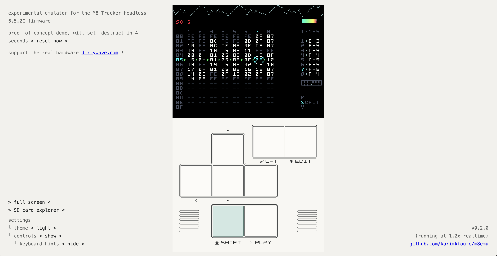

**(this experiment was based on Headless Firmware 6.5.2C. no other version is, or will ever be, supported!)**

try it here -> [https://m8.sidequesting.online/](https://m8.sidequesting.online/) 

(proof of concept demo, it auto resets every 120 seconds)

# m8emu

my experimental M8 tracker emulator. some features work but you'll stumble upon some fun artifacts, that's part of its charm: "like a circuit-bent m8"

it was built over the course of 6 weeks as a personal exploration of microcontroller firmware reverse engineering. I built a model-agnostic LLM harness to kick-start discovery and it took several revisions to guide it into producing a working proof of concept, exploring different implementations and coordinating further optimization loops. the process spanned over 1000 branches and 10000 commits.

> all of this was done using only the publicly released firmware .hex and the m8c frontend as references. **no physical Teensy 4.1 board was used in the process** (!)

## achieved performance

(realtime cpu usage multiplier, >1x means smooth playback)

| sample project (lightest to heaviest)| Linux x86_64 Ryzen 9 5900X | macOS M1 Pro | Linux arm64 Pi Zero 2 W | Chrome M1 Pro | Safari M1 Pro | Safari iPhone 15 Pro |
| --------------------------------------- | -------------------------: | -----------: | ----------------------: | ------------: | ------------: | -------------------: |
| 8 synths                                | **19.17×**                 | **16.80×**   | **1.25×**               | **6.76×**     | **5.78×**     | **4.97×**            |
| 15 instruments (3 samplers)             | **17.59×**                 | **16.16×**   | **1.14×**               | **5.38×**     | **4.99×**     | **4.31×**            |
| 23 hypersynths                          | **14.53×**                 | **14.44×**   | 0.98×                   | **5.34×**     | **4.77×**     | **4.10×**            |
| 3 synths                                | **14.30×**                 | **13.83×**   | 0.91×                   | **4.77×**     | **4.47×**     | **3.13×**            |
| 16 instruments (5 samplers)             | **9.43×**                  | **9.40×**    | 0.61×                   | **2.76×**     | **2.95×**     | **2.48×**            |
| 24 macrosynths                          | **9.17×**                  | **7.67×**    | 0.65×                   | **3.58×**     | **3.17×**     | **2.37×**            |
| 40 instruments (34 FM synths)           | **9.14×**                  | **8.95×**    | 0.70×                   | **3.84×**     | **2.92×**     | **2.47×**            |
| 21 instruments (13 FM synths)           | **8.66×**                  | **7.65×**    | 0.55×                   | **3.12×**     | **2.86×**     | **2.05×**            |
| 27 samplers                             | **7.12×**                  | **8.58×**    | 0.51×                   | **2.92×**     | **2.82×**     | **2.48×**            |
| 17 instruments (10 FM synths)           | **5.58×**                  | **4.50×**    | 0.43×                   | **2.15×**     | **1.85×**     | **1.37×**            |
| mean                                    | **10.67×**                 | **10.03×**   | 0.73×                   | **3.83×**     | **3.47×**     | **2.78×**            |