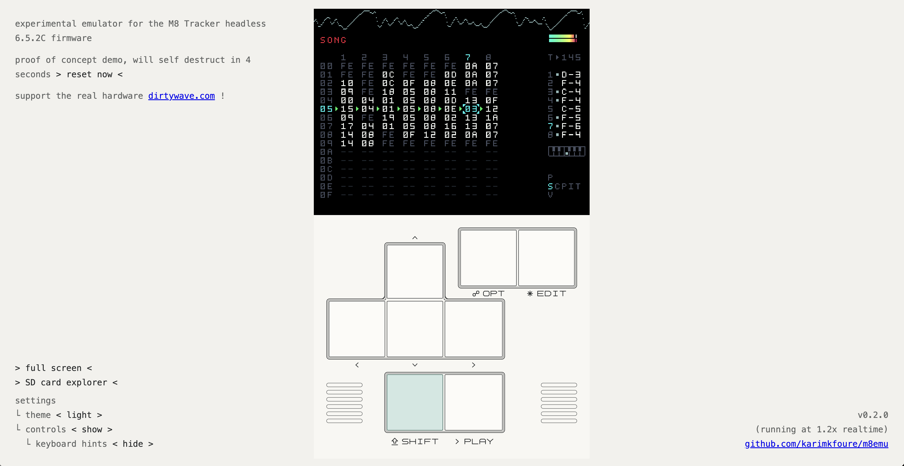
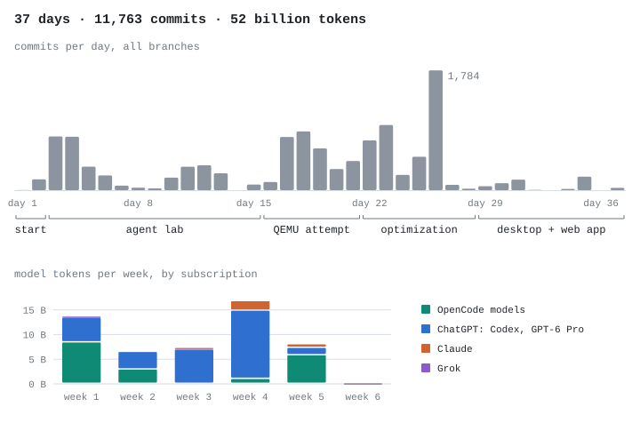
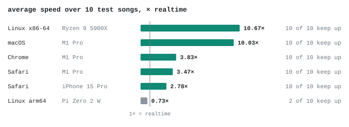
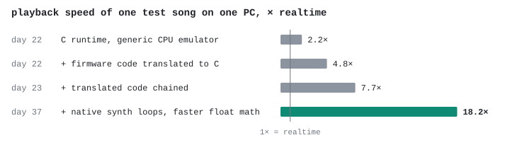

**(this experiment is based on Headless Firmware 6.5.2C. no other version is, or will ever be, supported!)**



try it here → [m8.sidequesting.online](https://m8.sidequesting.online/) (proof of concept, resets every 120 seconds)

# m8emu

my experimental M8 tracker emulator. some features work but you'll stumble upon some fun artifacts, that's part of its charm: "like a circuit-bent m8"

in early september 2026 the GPT Astra release kicked off a very expensive trend of reverse-engineering games and apps with models. I wanted to take that idea to its limit:

> **rebuild an entire hardware product from nothing but its compiled microcontroller firmware and public information**, driven by a custom harness running the cheapest model I could get (Meta Spark 1.3 Contributor).

**inputs**

- the publicly released firmware `.hex`
- the [m8c](https://github.com/laamaa/m8c) frontend, and a handful of M8 project files as test songs
- general tooling: [Unicorn](https://www.unicorn-engine.org/) as a CPU reference, [Ghidra](https://ghidra-sre.org/) for reading the binary

> **no physical Teensy 4.1 board,** no M8, no logic analyzer, no recordings of real hardware were used. the whole thing was built, debugged and validated against the binary and against slower software running that same binary.

and a few weeks later, it plays tracker songs at 18× realtime on a desktop!

## who actually did the reverse engineering

<picture>
  <source media="(prefers-color-scheme: dark)" srcset="assets/scale-dark.svg">
  
</picture>

mostly the models, in three stages:

- **the Spark harness.** a lab of cheap agents that split goals into tasks, ran each one in its own copy of the repo and reviewed the results. it carried most of the discovery and left behind a Ghidra database, a catalog of accepted findings and a first working build.
- **steering it by hand.** I dropped the lab on day 16 and worked with one coordinating model directly, mostly Codex. this is where the emulator became correct, and where it stayed slow.
- **Opus 5.5 as coordinator.** brought in on day 22 to break the plan rather than follow it. almost every optimization below comes from the two weeks after that.

7,569 of the 11,763 commits survived into the final main branch, and the busiest day went to the browser build and the translator.

## performance

<picture>
  <source media="(prefers-color-scheme: dark)" srcset="assets/targets-dark.svg">
  
</picture>

the benchmark measures how much audio the emulator renders per second of wall time. 

1× is realtime: at or above it the instrument plays without dropouts; below, it can't keep up. 

<details>
<summary><b>per-song numbers</b></summary>

<br>

| project, lightest to heaviest | Linux x86_64<br>Ryzen 9 5900X | macOS<br>M1 Pro | Linux arm64<br>Pi Zero 2 W | Chrome<br>M1 Pro | Safari<br>M1 Pro | Safari<br>iPhone 15 Pro |
| --- | ---: | ---: | ---: | ---: | ---: | ---: |
| 8 synths · 220 bpm | **19.17×** | **16.80×** | **1.25×** | **6.76×** | **5.78×** | **4.97×** |
| 15 instruments (3 samplers) · 128 bpm | **17.59×** | **16.16×** | **1.14×** | **5.38×** | **4.99×** | **4.31×** |
| 23 hypersynths · 160 bpm | **14.53×** | **14.44×** | 0.98× | **5.34×** | **4.77×** | **4.10×** |
| 3 synths · 140 bpm | **14.30×** | **13.83×** | 0.91× | **4.77×** | **4.47×** | **3.13×** |
| 16 instruments (5 samplers) · 120 bpm | **9.43×** | **9.40×** | 0.61× | **2.76×** | **2.95×** | **2.48×** |
| 24 macrosynths · 128 bpm | **9.17×** | **7.67×** | 0.65× | **3.58×** | **3.17×** | **2.37×** |
| 40 instruments (34 FM synths) · 120 bpm | **9.14×** | **8.95×** | 0.70× | **3.84×** | **2.92×** | **2.47×** |
| 21 instruments (13 FM synths) · 300 bpm | **8.66×** | **7.65×** | 0.55× | **3.12×** | **2.86×** | **2.05×** |
| 27 samplers · 82 bpm | **7.12×** | **8.58×** | 0.51× | **2.92×** | **2.82×** | **2.48×** |
| 17 instruments (10 FM synths) · 320 bpm | **5.58×** | **4.50×** | 0.43× | **2.15×** | **1.85×** | **1.37×** |
| geometric mean | **10.67×** | **10.03×** | 0.73× | **3.83×** | **3.47×** | **2.78×** |

</details>

## rebuilding a board you never touch

M8 Headless is Dirtywave's firmware for the Teensy 4.1, a board built around an NXP i.MX RT1062 (Arm Cortex-M7). for the original tracker, sequencer, synth engines and UI to run unmodified on a regular computer, enough of that board has to exist in software.

```
  firmware 6.5.2C .hex   ·  1,880,064 bytes of compiled Arm code
                         ·  no symbols, no source, no debug info
            │
            ▼
  Ghidra database        ·  1,710 functions named and typed
```

reading the binary is not the same as running it. the firmware only boots if the hardware around it answers the way it expects, and none of that hardware existed.

<details>
<summary><b>the six device models written for it</b></summary>

<br>

| what the firmware talks to | what had to be reproduced |
|---|---|
| audio output | the DMA engine that feeds the audio codec: its descriptors, how far through a buffer it is, and the interrupts the firmware waits on to fill the next block |
| the screen | the firmware draws nothing itself, it sends drawing commands over USB, and the emulator decodes them and hands them to m8c |
| keys and USB | the USB controller's transfer queues, so input going in and drawing commands coming out stay in order |
| SD card | the command set the firmware uses to read and write cards, including the partial transfers and errors it checks for |
| settings storage | the flash chip's write, erase and status commands |
| time | the cycle counter, the system tick, the watchdog and the interrupt controller |

</details>

the firmware itself runs through three levels, each one handing down what it can't do:

```
build:  firmware .hex ─▶ verify hash ─▶ decode Arm Thumb ─▶ generate C ─▶ compile (native or WebAssembly)

run:    translated blocks ─▶ per-instruction handlers ─▶ interpreter ─▶ stop with an error
```

none of Dirtywave's source code is involved: the C is a translation of the binary, and an instruction no level supports stops the emulator with an error instead of guessing.

the firmware never sees the host clock. it runs on **600 million emulated cycles per second**, advanced by its own waits and by the device models, which is what makes a run reproducible: the same input always produces the same audio, bit for bit.

floating point was the subtle part, since the chip's rules for NaNs, denormals and flush-to-zero don't match the host's everywhere. the cases that differ go through exact helpers, checked against the original Arm code.

once the firmware runs under your own control, it can also do things the original never did: saving and restoring the whole machine mid-song, editing the SD card from the host, running in a browser tab.

## getting it fast enough to play

on day 22 the emulator was a C runtime around a generic CPU emulator, playing one test song at 2.2× realtime on a desktop. two weeks of optimization took the same song to 18.2× on the same machine.

<picture>
  <source media="(prefers-color-scheme: dark)" srcset="assets/speed-dark.svg">
  
</picture>

| step | what changed | × realtime | gain |
|---|---|---:|---:|
| C runtime | time and the devices move into C; a generic CPU emulator still executes every firmware instruction | 2.2× | — |
| translation | firmware functions are translated to C ahead of playback instead of being interpreted | 4.8× | 2.2× |
| chaining | a translated block jumps straight into the next one instead of returning to the dispatcher | 7.7× | 1.6× |
| native loops and float work | the FM, hypersynth, effect and mixer loops run as native code; float state stays in host registers | 18.2× | 2.4× |

every build in that table produces the same audio, bit for bit, and ends at the same point in the song: the optimizations could change how the firmware ran, never what it computed. a native loop only runs when a check says the current state is one it was written for; anything else falls back to the translated code.

five routes that were measured and dropped

| tried | why it stopped |
|---|---|
| the whole board in QEMU | a correct three-note phrase, never a song |
| caching repeated render calls | only 0.34% of playback work was reusable, and a cache key built from the arguments alone could return wrong results |
| a general DSP compiler | 1.066× at best |
| running synth voices on several CPU threads | unsafe cases in the shared state; even an idealized model gave 1.017× |
| recompiling the FM code through LLVM | 6.67% more instructions than the existing C during real playback |


## how do you validate an emulator with no hardware to compare against?

you compare it against slower software running the same firmware, and you compare bytes instead of impressions

| check | what it compares | what it catches | result |
|---|---|---|---|
| reference build | the product against a build where a generic CPU emulator executes every instruction — 9,896 runs with randomized edits and timing | translation and optimization bugs | 9,892 identical in audio and timing, 4 stopped at the same point in both, **0 differences** |
| song corpus | 203 projects, 6 seconds of each, on x86 and on emulated ARM64 | host, compiler and architecture dependencies | **203 of 203** identical to the reference |
| edit replay | 76 edits with playback stopped, in the product, the reference build and the original Python runtime | sequencer and UI state, which audio never shows | same final screen in all three |
| benchmark | 10 songs on 6 targets | optimizations that are only fast because they're wrong | **60 of 60** with the expected audio hash |

what none of them can catch: all four share the same device models, so a device model that misreads the real hardware would look correct in every one. nothing here was ever compared against audio recorded from a physical M8.

that gap showed itself once, early. for days the firmware booted, drew its screens, took input and played silence; its audio buffer pool only ever got 2 pages. it was reading the end of flash for a signature that a real Teensy carries there and the `.hex` doesn't include. supplying those four bytes grew the pool to 56 pages and the synth voices started getting their buffers. nothing in the firmware was patched, the emulated board was missing something a real one has.

with that reference in place, every optimization became a yes-or-no question instead of an argument. the gates each one had to pass:

1. **estimate the ceiling first.** a general DSP compiler was capped at 1.066× by a model of its target loops, so it was never built.
2. **build it in a separate copy of the repo.**
3. **same audio, same cycle count?** this is where a float shortcut that rounded a tiny value differently got caught.
4. **actually faster on the target machine?** LLVM-compiled FM code had 3.96% fewer instructions in isolation and 6.67% more during real playback, so it was dropped.
5. **merge.** chaining went in this way, and the test song went from 4.8× to 7.7× that day.

## what 52 billion tokens actually cost

| | tokens | share |
|---|---|---:|
| cache reads | 49.98 B | 96.1% |
| uncached input | 1.79 B | 3.4% |
| cache writes | 0.02 B | 0.04% |
| output | 0.22 B | 0.4% |

paid through subscriptions, the whole project cost about **USD 254**. the same traffic at per-token API rates would have been about **USD 10.7k**, 42× more. (both figures are estimates)

## credits

- [Dirtywave](https://dirtywave.com/) for the M8 and the publicly released [headless firmware](https://github.com/Dirtywave/M8HeadlessFirmware)
- [m8c](https://github.com/laamaa/m8c), the reference frontend, also used as the renderer
- [Unicorn](https://www.unicorn-engine.org/), the CPU reference
- [Ghidra](https://ghidra-sre.org/), for reading the binary
- [SDL](https://www.libsdl.org/), [WASI SDK](https://github.com/WebAssembly/wasi-sdk), [Binaryen](https://github.com/WebAssembly/binaryen), [BOLT](https://github.com/llvm/llvm-project/tree/main/bolt), QEMU
- [PJRC](https://www.pjrc.com/store/teensy41.html) for the Teensy 4.1 specs
- models: OpenCode with Muse Spark 1.3 Contributor (via OpenCode Go), Codex with Astra and Sol (gpt-6.1-sol) and Claude Code with Opus 5.5
